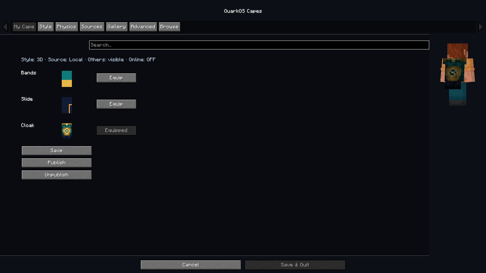
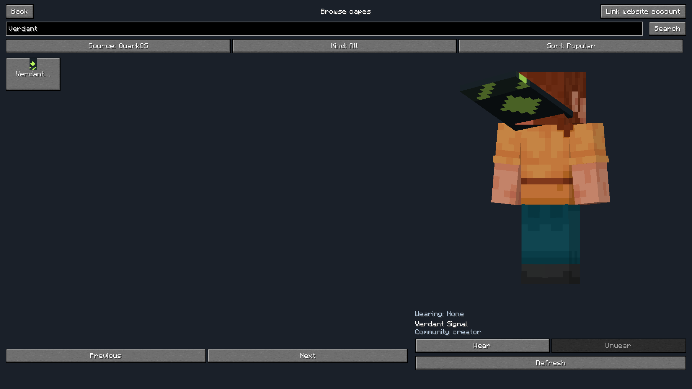
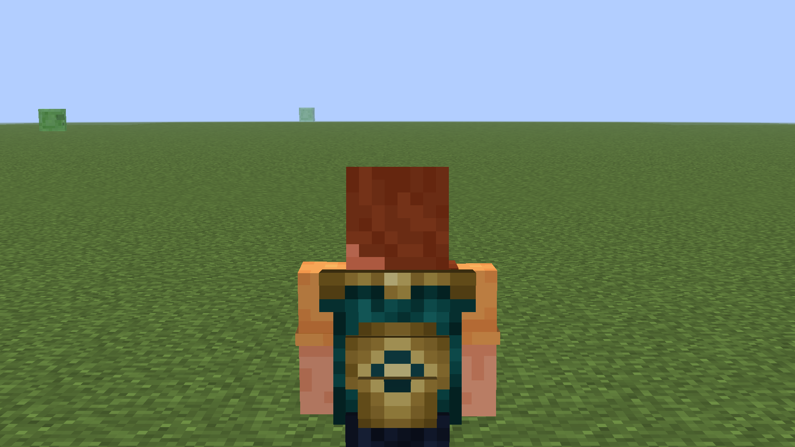
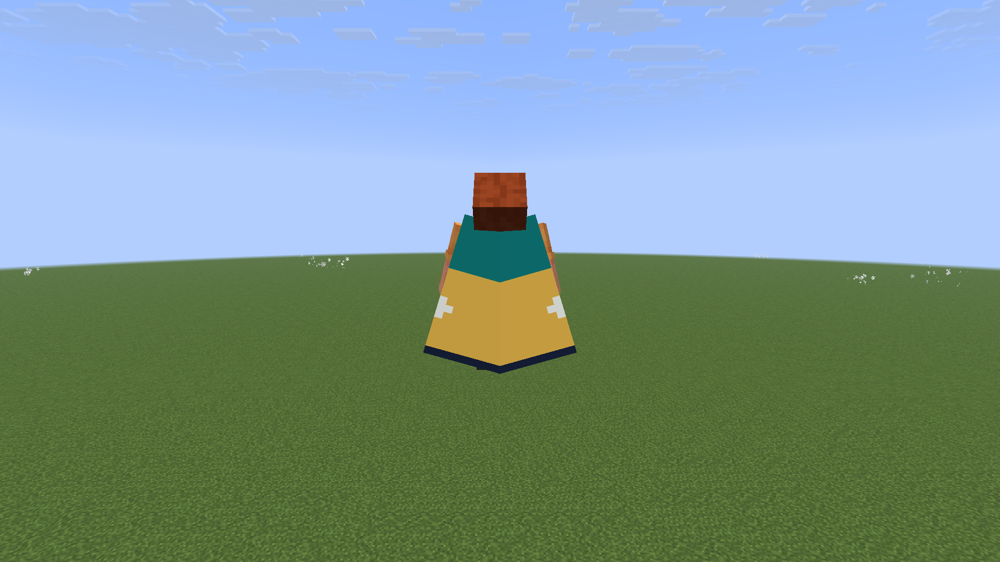
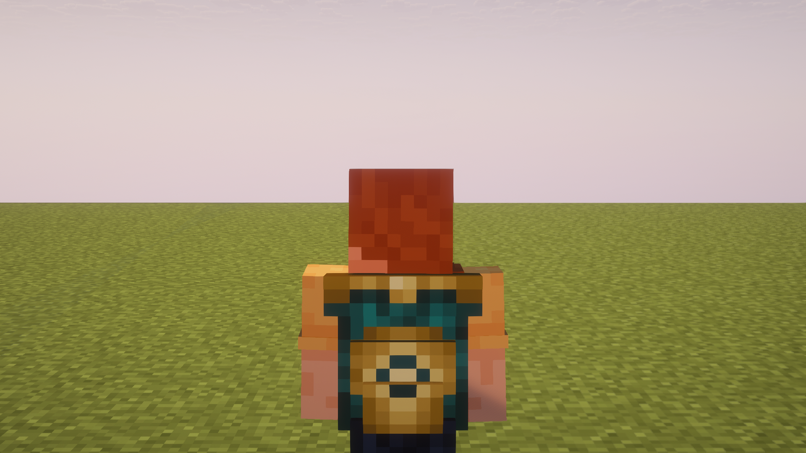
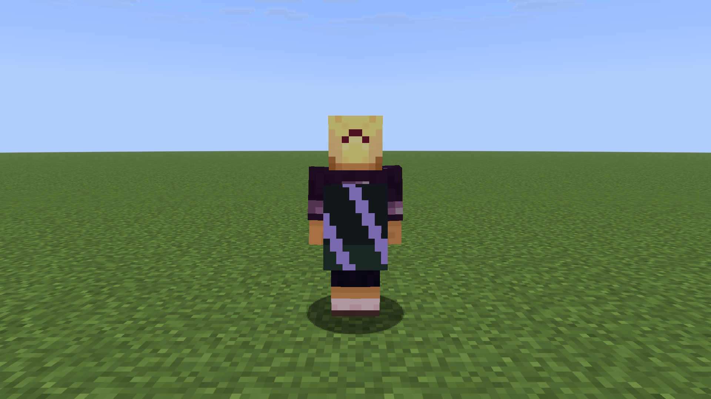

<!-- DRAFT for CurseForge. Do not upload until Emilio approves. The four URLs in gradle.properties are still placeholders. -->
# QuarkOS Capes

Free capes with animation, cloth physics and 3D cloaks, plus one-click wear from the QuarkOS Capes website.

**Features**
- Flat, animated frame strip, waving cloth, or 3D model cloak.
- Tunable physics: Classic or Cloth (soft/stiff), Smooth or Blocky look, Wind on/off, gravity.
- Live player preview on settings and Browse when the window has room.
- Browse: search, filter, sort, preview, Wear and Unwear capes from the site.
- Online players with Show others enabled can see website-worn and published capes. LabyMod wearing references also require that source switch. Local samples and edits stay local until shared.
- Optional read-only sources: OptiFine, LabyMod, MinecraftCapes, Cosmetica, Cloaks+.
- Link a website account with a code. Share a cape to the gallery.
- A 2:1 cape image also shows on elytra.
- Offline mode on by default.

Press **O** to open settings. Six categories: My Cape, Style, Physics, Sources, Gallery, Advanced. Browse is a separate screen.

**Requirements**
- Fabric: Fabric Loader 0.16.0+, Fabric API. Cloth Config is bundled. Mod Menu is optional. Minecraft 1.20.1, 1.21.1, 1.21.4, 1.21.8, 1.21.11.
- Forge: the same Minecraft versions. Cloth Config is bundled on 1.20.1 and 1.21.1.
- NeoForge: 1.21.1, 1.21.4, 1.21.8, 1.21.11. Cloth Config is bundled on 1.21.1.
- Java 21. Client-side only.

LabyMod capes are credited to LabyMod. This mod is not affiliated with LabyMod, Mojang, or Microsoft.
Homepage, source, and issues are still the placeholder lines `quarkos.homepage`, `quarkos.source`, and `quarkos.issues` in `gradle.properties`.
License: MIT. Author: Emilio Schwaiger (QuarkOS).

Website features require an available configured service and online mode. Wear, Unwear, Link, and publishing require a signed-in Minecraft session.
