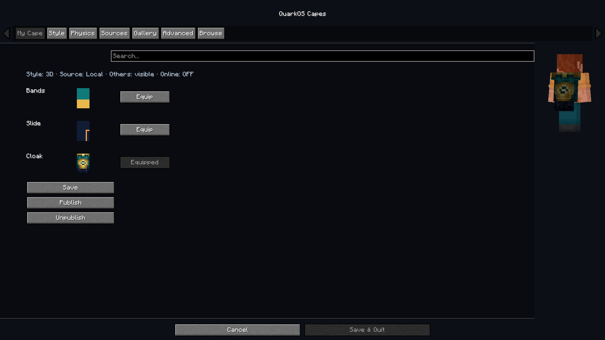
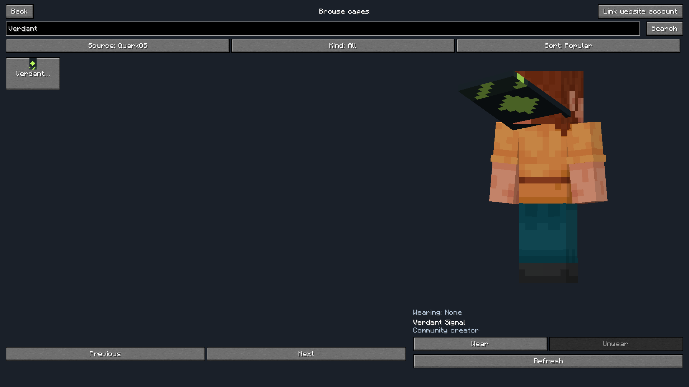
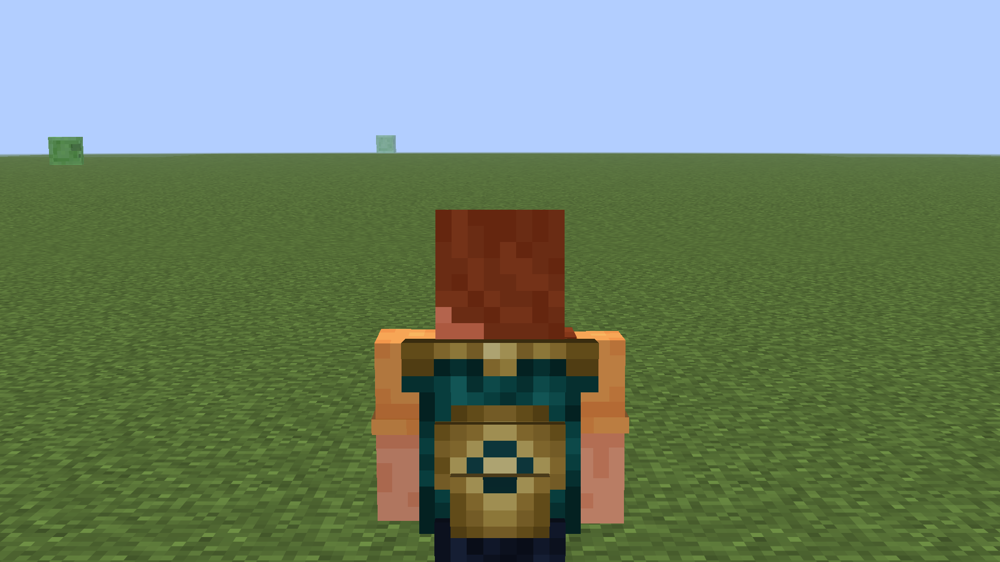
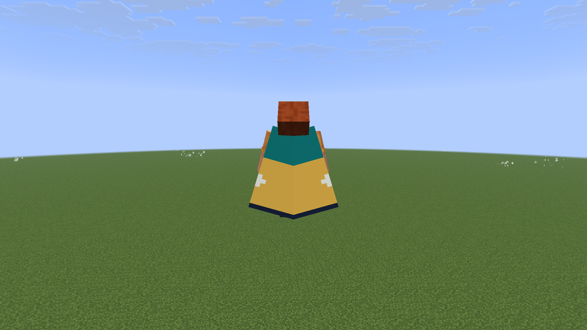
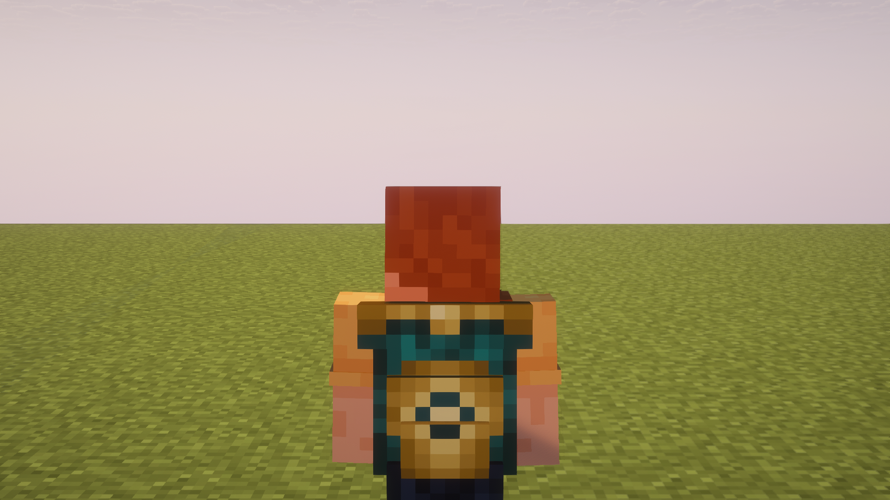
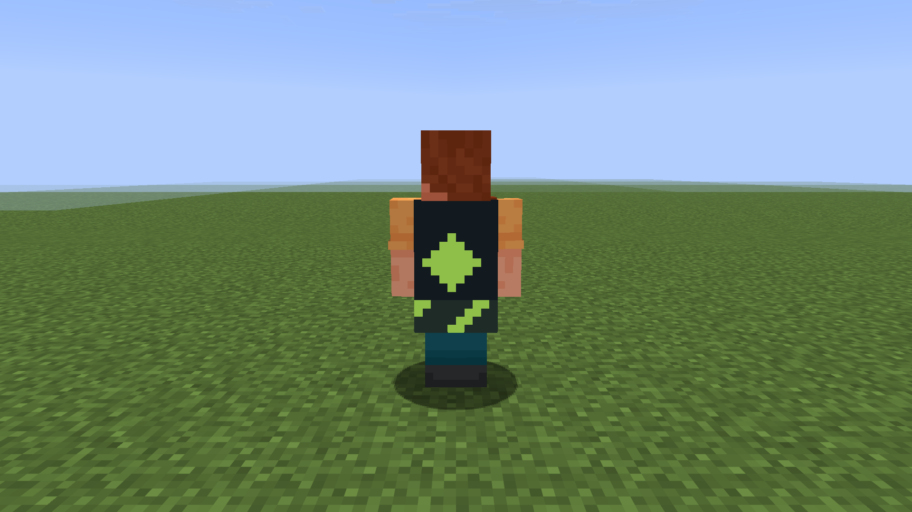

<!-- DRAFT for Modrinth. Do not upload until Emilio approves. The four URLs in gradle.properties are still placeholders. -->
# QuarkOS Capes

Capes for everyone, no paywall. Pick a cape, make it move the way you like, and wear capes from the QuarkOS Capes website with one click in game.

## Features

- **Your own cape, your way.** Flat like vanilla, an animated frame strip, a cloth cape that waves, or a 3D model cloak.
- **Physics you can tune.** Classic vanilla movement or cloth simulation (soft or stiff), smooth or blocky look, wind on or off, and a gravity slider.
- **Live preview.** Settings and Browse show your player wearing the cape when the window has room. Show back turns the preview so you see the cape.
- **Browse in game.** Browse lists capes and cloaks from the QuarkOS Capes site. Search, filter by source and kind, sort by Popular, Newest or Name, preview on your player, then Wear or Unwear.
- **One-click wear.** Wearing a cape from Browse saves a reference for your Minecraft identity on the site. Other online players with the mod and Show others enabled can see it.
- **See other players' capes.** Online players with Show others enabled can see website-worn and published capes. Local samples and edits stay local until shared. Optional read-only sources (OptiFine, LabyMod, MinecraftCapes, Cosmetica, Cloaks+) can be switched on in Sources.
- **Link your website account** from in game with a short code from the site.
- **Share your own cape** to the gallery, search it, and unpublish it any time.
- **Elytra support.** A 2:1 cape image also shows on your elytra.
- **Privacy first.** Offline mode is on by default: the mod sends no network request until you switch it off.

Open the settings with **O** (rebindable), or from Mod Menu on Fabric / the Mods list on Forge and NeoForge. The settings screen has six categories: My Cape, Style, Physics, Sources, Gallery, and Advanced. Browse is a separate screen.

## Requirements

| | Fabric | Forge | NeoForge |
| --- | --- | --- | --- |
| Minecraft | 1.20.1, 1.21.1, 1.21.4, 1.21.8, 1.21.11 | same | 1.21.1, 1.21.4, 1.21.8, 1.21.11 |
| Loader | Fabric Loader 0.16.0+ | the build named in the file | the build named in the file |
| Required | Fabric API | — | — |
| Bundled | Cloth Config (LGPL-3.0, by shedaniel), OkHttp, Okio | Cloth Config on 1.20.1 and 1.21.1, OkHttp, Okio | Cloth Config on 1.21.1, OkHttp, Okio |
| Optional | Mod Menu | — | — |

Client-side only. Servers do not need it. Java 21.

## Notes

- LabyMod capes are shown with credit to LabyMod. QuarkOS Capes is not affiliated with LabyMod, Mojang, or Microsoft.
- No textures from Mojang, Minecon, or Migrator ship in the jar.
- Homepage, source, and issues are the `quarkos.homepage`, `quarkos.source`, and `quarkos.issues` lines in `gradle.properties`. Those three, and `quarkos.serviceUrl`, are still placeholders.

Original mod code: MIT. Bundled libraries retain their licenses. Made by Emilio Schwaiger (QuarkOS).

Website features require the configured service and online mode. Wear, Unwear, Link, and publishing require a signed-in Minecraft session.
